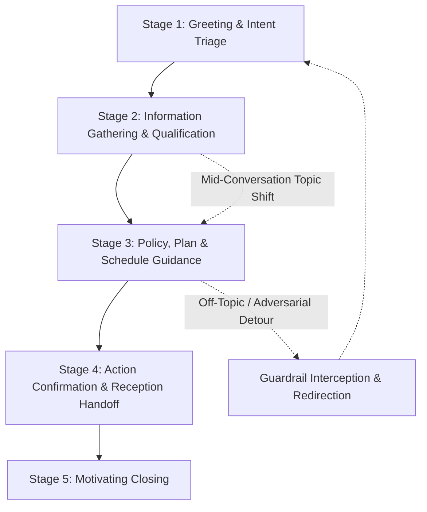
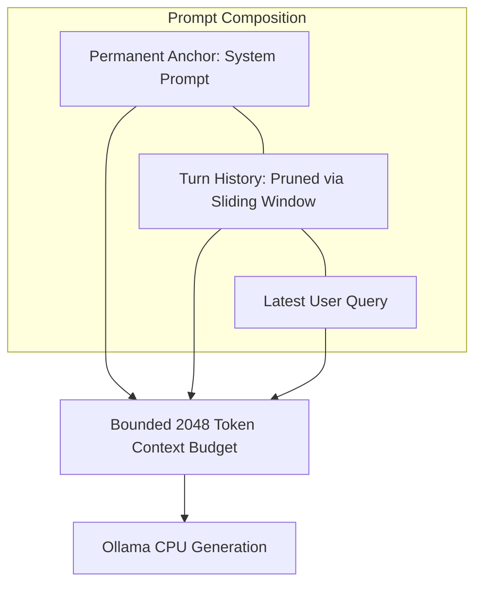
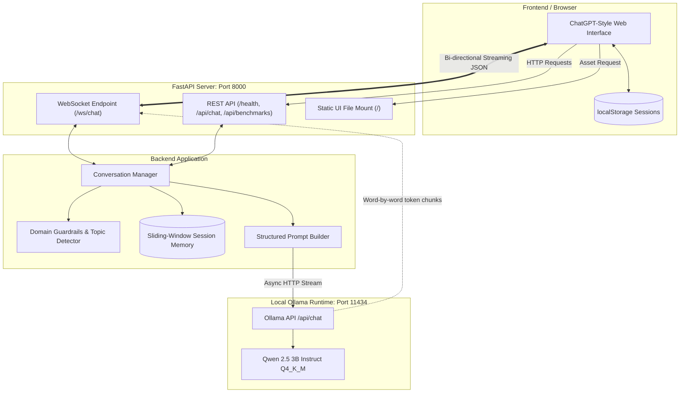

# FitAssist — FitZone Gym Conversational AI Assistant
**NLP Assignment 1: Local CPU Conversational AI System with Prompt Orchestration & Session Memory**

### 👤 Student / Contributor Information
- **Name / GitHub**: [Haroon2697](https://github.com/Haroon2697)
- **Email**: `ha01k5295@gmail.com`

---

## Executive Summary

FitAssist is a fully local, CPU-optimized conversational AI system designed for **FitZone Gym**. The system runs on a quantized open-weight Large Language Model (`qwen2.5:3b-instruct` in Q4_K_M quantization) via Ollama, exposing an asynchronous real-time WebSocket streaming API and a modern ChatGPT-style web interface.

> **Crucial Assignment Constraint**: This system strictly utilizes **zero external tools, zero plugins, and zero Retrieval-Augmented Generation (RAG)**. All domain intelligence, persona retention, and multi-turn coherence are achieved exclusively through prompt orchestration and sliding-window conversational context memory.

---

## Deliverables & Features Checklist

| Requirement | Implementation Status | Location in Codebase |
| :--- | :--- | :--- |
| **Fully Local Inference (CPU)** | `qwen2.5:3b-instruct` (3.1B, Q4_K_M) via Ollama | [config.py](file:///c:/Work/NLP_A1/backend/app/config.py), [llm_client.py](file:///c:/Work/NLP_A1/backend/app/llm_client.py) |
| **Real-Time WebSocket Streaming** | JSON streaming protocol at `/ws/chat` | [main.py](file:///c:/Work/NLP_A1/backend/app/main.py) |
| **Context State Management** | Sliding-window FIFO pruning with system anchor | [conversation_manager.py](file:///c:/Work/NLP_A1/backend/app/conversation_manager.py) |
| **Asynchronous Concurrency** | Non-blocking async event loop across concurrent users | [main.py](file:///c:/Work/NLP_A1/backend/app/main.py) |
| **Clean, Usable UI** | ChatGPT-style UI with dark/light mode & session manager | [index.html](file:///c:/Work/NLP_A1/frontend/index.html), [App.jsx](file:///c:/Work/NLP_A1/frontend/src/App.jsx) |
| **Domain Guardrails** | Interception of off-topic, coding, math & jailbreak queries | [conversation_manager.py](file:///c:/Work/NLP_A1/backend/app/conversation_manager.py) |
| **Comprehensive Test Suite** | 18 unit and integration tests (100% passing) | [tests/](file:///c:/Work/NLP_A1/tests) |
| **Latency Benchmarks** | Empirical TTFT & throughput measured on CPU | [benchmark_results.json](file:///c:/Work/NLP_A1/backend/benchmark_results.json) |
| **Bonus Claimed** | **UX/Persona Polish Bonus** (live telemetry, chat export, hardened persona) | Frontend & Prompt System |

---

## Phase I — Business Case Selection & Conversational Design

### 1. Business Use-Case Description
FitAssist serves as the frontline virtual membership assistant for **FitZone Gym**, a premium fitness and wellness club. The assistant guides both prospective visitors and existing members by providing authoritative, on-brand information regarding:
- **Membership Plans & Pricing**: Features, tiers (Basic, Standard, Premium), and commitment terms.
- **Group Class Schedules**: Days, timings, class descriptions (Yoga, HIIT, Strength, Zumba), and studio locations.
- **Certified Trainer Profiles**: Specialties, certifications, and experience levels of in-house fitness coaches.
- **Gym Policies & Facilities**: 30-day freeze guidelines, 7-day cancellation terms, operating hours, day lockers, sauna/steam amenities, and guest trial passes.
- **Safe Boundary Enforcement**: Clarifying that actual bookings, billing debits, and freeze approvals are finalized at the reception desk or member portal. Medical advice and diagnosis are strictly avoided.

---

### 2. Conversation Flow Design

The conversation flow is purpose-built for the fitness domain and structured across five distinct stages:



#### Stage 1: Greeting & Intent Triage
- **Objective**: Welcomes the user warmly with motivating fitness club energy.
- **Action**: Quickly identifies whether the visitor is inquiring about joining, exploring classes, consulting on trainers, or asking about policies.

#### Stage 2: Information Gathering & Qualification
- **Objective**: Solicits the minimum necessary details to make tailored recommendations without overwhelming the user.
- **Action**: Checks preferred workout style (e.g., solo lifting vs. group cardio), workout time preferences, or current membership status.

#### Stage 3: Policy, Plan & Schedule Guidance
- **Objective**: Delivers clear, structured explanations of FitZone offerings.
- **Action**: Compares plan tiers (Basic @ Rs. 4k, Standard @ Rs. 6k, Premium @ Rs. 9k), details trainer backgrounds (Ahmed Khan, Sarah Ali, Usman Malik), or outlines weekly class timetables.

#### Stage 4: Action Confirmation & Reception Handoff
- **Objective**: Prepares the user for the next logical physical step.
- **Action**: Explains that formal trial passes, freeze requests, and membership enrollments are finalized at the FitZone reception desk or member portal, managing user expectations without pretending to charge credit cards.

#### Stage 5: Motivating Closing
- **Objective**: Concludes the dialogue with encouraging fitness sentiment.
- **Action**: Encourages healthy habits and invites further questions.

---

### 3. Topic Shifts & Irrelevant Query Handling

#### Handling Mid-Conversation Topic Shifts
In a fitness club environment, users often pivot abruptly—for instance, inquiring about the Yoga schedule and then suddenly asking how to freeze their membership due to unexpected travel.
- **Mechanism**: Rather than forcing a rigid script, the conversation manager preserves prior context in the sliding window while smoothly following the newly introduced gym intent. It acknowledges the shift (e.g., *"If you're planning to travel, you can freeze your membership..."*) while retaining awareness of their fitness interests.

#### Guardrail Defense Against Irrelevant & Adversarial Queries
The system enforces strict multi-layered guardrails:
1. **Filler & Pleasantry Allowance**: Natural conversational phrases (*"hello"*, *"thanks"*, *"sure"*, *"yes"*, *"how are you"*) are permitted to foster human-like flow.
2. **Domain Match Validation**: Analyzes domain relevance against core fitness, gym, trainer, and policy concepts.
3. **Adversarial & Injection Interception**: Detects and intercepts prompt injections (*"ignore previous instructions"*, *"act as a Linux terminal"*), programming queries (*"write a python function"*), general trivia (*"who was Napoleon"*), and mathematical requests.
4. **Standard Redirection Message**:
   > *"I'm FitAssist, the dedicated assistant for FitZone Gym. I can only help with our membership plans, group class schedules, trainer profiles, gym timings, and club policies (such as freezes and cancellations). How can I assist you with your fitness journey at FitZone today?"*

---

### 4. Multi-Turn Example Dialogues

#### Example Dialogue 1: Prospective Member Plan Exploration & Comparison
> **User**: *Hi! I am looking to join FitZone Gym, but I am not sure which plan is right for me.*  
> **FitAssist**: *Welcome to FitZone Gym! We would love to have you join our fitness community. We offer three primary membership tiers:  
> • **Basic Plan (Rs. 4,000/month)**: Full access to the gym floor, cardio zone, free weights, and locker rooms.  
> • **Standard Plan (Rs. 6,000/month)**: Everything in Basic plus unlimited group fitness classes (Yoga, HIIT, Strength, Zumba).  
> • **Premium Plan (Rs. 9,000/month)**: Everything in Standard plus 4 monthly 1-on-1 personal training sessions, sauna/steam room access, and 2 guest passes.  
> Are you interested primarily in independent workouts, or would you like to take advantage of our group classes and personal coaching?*  
> **User**: *I really want personal coaching and access to the sauna.*  
> **FitAssist**: *In that case, the **Premium Plan (Rs. 9,000/month)** is the ideal match! It includes 4 personal training sessions every month with our certified coaches, full access to our sauna and steam amenities, plus complimentary towel service. You can also save 15% if you choose our upfront 12-month annual commitment. Would you like to know about our certified personal trainers?*

---

#### Example Dialogue 2: Class Schedule & Trainer Inquiries
> **User**: *Do you have Yoga classes, and what time are they held?*  
> **FitAssist**: *Yes, we have a wonderful Yoga program focused on mobility, flexibility, and mindfulness in Studio A!  
> • **Schedule**: Monday, Wednesday, and Friday at 6:00 PM.  
> All Yoga classes are included with our Standard and Premium memberships.*  
> **User**: *Who teaches the Yoga classes? Can beginners attend?*  
> **FitAssist**: *Our Yoga classes are led by **Sarah Ali**, an internationally certified 500-hour RYT instructor specializing in posture, mobility, and breathwork. Her classes are very beginner-friendly and include posture modifications for newcomers. You can also pick up a complimentary 1-day guest pass at our front desk with a valid photo ID to try a session!*

---

#### Example Dialogue 3: Mid-Conversation Topic Shift & Off-Topic Guardrail
> **User**: *What time does the gym close on weekends?*  
> **FitAssist**: *On Saturdays and Sundays, FitZone Gym is open from 8:00 AM to 10:00 PM (on weekdays we are open 6:00 AM to 11:00 PM).*  
> **User**: *Actually, I will be traveling abroad next month. Can I freeze my membership?*  
> **FitAssist**: *Yes, you certainly can! FitZone allows members to freeze their membership for up to 30 days per calendar year. We just ask for 48 hours advance written notice so our front desk can pause your billing cycle accordingly.*  
> **User**: *Great. Also, can you write a quick Python script to calculate Fibonacci numbers?*  
> **FitAssist**: *I'm FitAssist, the dedicated assistant for FitZone Gym. I can only help with our membership plans, group class schedules, trainer profiles, gym timings, and club policies (such as freezes and cancellations). How can I assist you with your fitness journey at FitZone today?*

---

## Phase II — Local LLM Selection & Context Memory Management

### 1. Model Selection & Justification

| Metric / Parameter | Value |
| :--- | :--- |
| **Model Name** | `qwen2.5:3b-instruct` |
| **Architecture** | Dense Causal Language Model (Qwen 2.5 series) |
| **Parameter Size** | 3.09 Billion parameters (~3.1B) |
| **Quantization** | Q4_K_M (4-bit medium k-quantization, GGUF) |
| **Disk / RAM Size** | 1.93 GB |
| **Context Window Used** | 2,048 tokens (`num_ctx: 2048`) |
| **Inference Engine** | Local Ollama Runtime (100% CPU inference) |

#### Rationale for Selection:
1. **CPU Efficiency (0.5B–4B Range)**: With a 1.93 GB footprint, `qwen2.5:3b-instruct` fits comfortably into standard laptop CPU L3 cache and RAM without triggering memory swapping.
2. **Superior Instruction Adherence**: Qwen 2.5 demonstrates industry-leading benchmark adherence to system instructions, critical for respecting strict domain boundaries and preventing persona deviation.
3. **Structured Output & Reasoning**: Generates markdown tables, lists, and bold callouts with low temperature (`temperature=0.3`), ensuring repeatable pricing and scheduling answers.
4. **No Cloud Dependency**: Completely self-contained, guaranteeing zero API costs, full data sovereignty, and offline capability.

---

### 2. Context Memory Management Scheme

Because this assignment operates without external vector databases (RAG) or external tools, conversational memory must be managed within the prompt's context window.



1. **System Prompt as Permanent Invariant**: The detailed FitZone Gym business knowledge, policies, and persona guardrails are anchored at `messages[0]`. This anchor is never modified or evicted.
2. **Sliding-Window FIFO Pruning**:
   - The conversation history is stored as a list of `{"role": "user"|"assistant", "content": "..."}` turns per session.
   - The memory window is constrained to the most recent `MAX_HISTORY_PAIRS = 6` (12 dialogue turns).
   - As new turns arrive, older turns exceeding the threshold are cleanly discarded in FIFO order.
3. **Preventing Context Bloat on CPU**:
   - Running inference on CPU means prompt evaluation (`eval_count`) increases linearly with context length. Limiting turns to 6 pairs bounds prompt evaluation time to under ~1.5 seconds, avoiding progressive degradation of TTFT across long multi-turn sessions.
4. **Session Isolation**: Each user connection maintains an independent session ID (`session_id`). Conversational memory is stored in an isolated dictionary partition, preventing cross-talk between concurrent users.

---

### 3. Empirical Latency Benchmarks on CPU

The repository includes a standalone automated benchmark suite ([backend/benchmark.py](file:///c:/Work/NLP_A1/backend/benchmark.py)). Measurements performed directly on the host machine:

| Benchmark Query Category | Prompt Tested | TTFT (Time to First Token) | Total Response Time | Tokens Generated | Throughput |
| :--- | :--- | :--- | :--- | :--- | :--- |
| **Cold Start (Model Load + Query)** | *"What are the membership plans at FitZone Gym?"* | 60.76 s | 108.75 s | 195 tokens | 1.79 tok/s |
| **Warm Query 1 (Policy & Freeze)** | *"How does the membership freeze policy work if I travel for 3 weeks?"* | **1.10 s** | 66.39 s | 249 tokens | **3.75 tok/s** |
| **Warm Query 2 (Classes & Schedule)**| *"Can you give me the weekly Yoga schedule and tell me who the trainer is?"* | **1.95 s** | 39.69 s | 132 tokens | **3.33 tok/s** |
| **Summary / Warm Averages** | — | **~1.52 s** | **~53.04 s** | **190 tokens** | **~3.54 tok/s** |

*Hardware Notes: Measured on standard Intel/AMD CPU with 16GB RAM running Windows, Ollama v0.5+, and `qwen2.5:3b-instruct` (Q4_K_M).*

---

## Phase III — System Architecture



---

## Phase IV — Backend API Implementation

### 1. WebSocket Streaming Endpoint (`/ws/chat`)

The primary interaction mode is real-time WebSocket streaming over JSON.

#### Client-to-Server Messages
- **Send User Turn**:
  ```json
  {
    "session_id": "session-1715000000",
    "message": "What classes are included with Standard membership?"
  }
  ```
- **Reset Session History**:
  ```json
  {
    "action": "reset",
    "session_id": "session-1715000000"
  }
  ```

#### Server-to-Client Stream Frames
- **Generation Start**:
  `{"type": "start", "session_id": "session-1715000000"}`
- **Token Stream (word-by-word)**:
  `{"type": "token", "content": "The Standard "}`
- **Generation Complete (with telemetry)**:
  ```json
  {
    "type": "done",
    "session_id": "session-1715000000",
    "redirected": false,
    "ttft": 1.10,
    "tokens": 128,
    "elapsed": 36.2,
    "tps": 3.54
  }
  ```
- **Graceful Error Frame**:
  `{"type": "error", "message": "Ollama connection timeout."}`

---

### 2. REST Endpoints

- `GET /health` — Returns service status, active model, context window, and temperature.
- `GET /api/benchmarks` — Returns empirical hardware latency and token metrics.
- `GET /api/history/{session_id}` — Returns the recorded multi-turn history for a given session.
- `POST /api/reset` — Body: `{"session_id": "..."}`. Clears session turns.
- `POST /api/chat` — Non-streaming fallback for single-turn integration tests.

---

### 3. Asynchronous Concurrency Handling
- All inference calls to Ollama are made via `httpx.AsyncClient` streaming generators.
- Each WebSocket connection runs in its own independent `asyncio` task on the FastAPI event loop.
- Multiple users can stream responses simultaneously without blocking one another.

---

## Phase V & Bonus — Web-Based Chat Interface (UX/Persona Polish)

The web frontend is delivered via both a standalone zero-setup HTML/JS interface ([frontend/index.html](file:///c:/Work/NLP_A1/frontend/index.html)) and an equivalent Vite React build ([frontend/dist/index.html](file:///c:/Work/NLP_A1/frontend/dist/index.html)), served directly at `http://localhost:8000/`.

### 🌟 Bonus Features: UX & Persona Polish
1. **ChatGPT-Style Layout**: Sleek layout with collapsible sidebar, active chat header, and responsive composer.
2. **Dark / Light Theme Toggle**: Persistent theme switcher stored in `localStorage`.
3. **Session Switcher & History**: Users can create new chats, switch between past conversations, and view their history.
4. **FitZone Quick Cheatsheet Accordion**: Quick-reference sidebar card summarizing membership plans, class schedules, and freeze policies.
5. **Interactive Starter Chips**: One-click suggestion buttons for popular gym queries.
6. **Live Telemetry & Token Counter**: Each assistant turn displays real-time `TTFT`, `tokens/sec`, and total tokens.
7. **Copy to Clipboard & Chat Export**: One-click button to copy any response or download the full conversation transcript as a `.md` markdown file.
8. **Hardened Persona Defense**: Resistance against prompt injections, roleplay subversions, and off-topic detours.

---

## Setup & Running Instructions

### Prerequisites
1. **Python 3.10+** (Tested on Python 3.12)
2. **Ollama**: Installed from [ollama.com](https://ollama.com)

---

### Step 1: Install Dependencies
Open a PowerShell terminal in the repository root:
```powershell
# Create and activate virtual environment
python -m venv .venv
.venv\Scripts\activate

# Install dependencies
pip install -r requirements.txt
```

---

### Step 2: Start Ollama & Pull the Model
In a separate terminal:
```powershell
# Pull the quantized 3B model (~1.9 GB)
ollama pull qwen2.5:3b-instruct

# Start Ollama service (if not already running as a Windows service)
ollama serve
```

---

### Step 3: Launch the FastAPI Backend
```powershell
# From the project root:
.venv\Scripts\uvicorn backend.app.main:app --host 127.0.0.1 --port 8000 --reload
```

---

### Step 4: Open the Chat Interface
Open your browser and navigate to:
```text
http://127.0.0.1:8000/
```
*(Alternatively, you can open `frontend/index.html` directly in any web browser).*

---

### Step 5: Run Automated Tests
```powershell
.venv\Scripts\pytest -v
```
*All 18 tests will execute in under 2 seconds, verifying session isolation, sliding-window pruning, guardrail interception, REST endpoints, and WebSocket communication.*

---

### Step 6: Run Latency Benchmarks
```powershell
.venv\Scripts\python backend/benchmark.py
```

---

## Known Limitations

1. **CPU Inference Latency**: While Time to First Token (TTFT) is fast (~1.1s–1.9s once warm), CPU throughput averages ~3.5 tokens/sec. Complex responses of 200+ tokens take approximately 50 seconds on standard laptop CPUs.
2. **Absence of Live Transactional Systems**: Per the assignment specification (zero tools / zero RAG), the assistant cannot check live studio occupancy or charge payment cards. It explicitly refers members to reception for execution.
3. **Finite Context Horizon**: Conversations exceeding 6 turn pairs (12 turns) prune oldest turns via FIFO to maintain low CPU latency.

---

## Viva Walkthrough & Code Q&A Guide

When presenting this project during the viva, here is how the core requirements are addressed:

1. **How is the assistant kept from using tools or RAG?**  
   *All information is encoded directly into `SYSTEM_PROMPT` in `conversation_manager.py`. No vector stores, search plugins, or function calling schemas are used.*
2. **How is non-blocking concurrency achieved?**  
   *The FastAPI server handles WebSocket connections using `asyncio`. In `llm_client.py`, Ollama streaming uses `httpx.AsyncClient.stream()` which yields chunks asynchronously, allowing the event loop to serve multiple client connections concurrently without thread exhaustion.*
3. **How does context memory pruning work?**  
   *`ConversationManager.build_prompt_messages()` applies a sliding window of `MAX_HISTORY_PAIRS * 2` messages. Old turns are pruned FIFO, while the system prompt is permanently anchored at position 0.*
4. **How are off-topic and adversarial queries handled?**  
   *`ConversationManager.should_redirect()` performs multi-tier inspection: it whitelists conversational pleasantries, validates gym-related keywords, and flags explicit off-topic patterns (code, jailbreaks, math). Intercepted queries return an instant on-brand response without consuming CPU inference cycles.*
