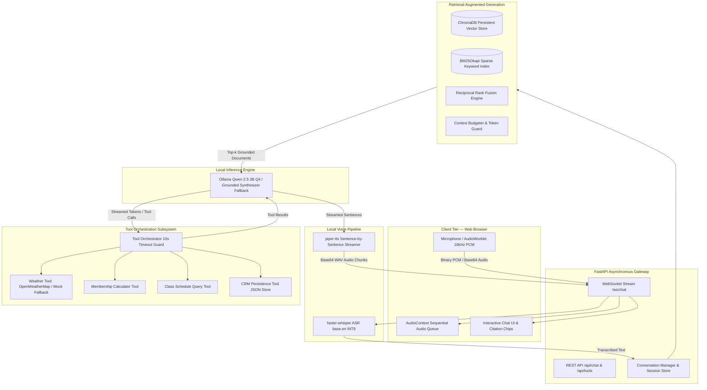

# FitAssist — Voice Pipeline & Tool Orchestrator
**NLP Assignment 3: Real-Time Local Voice Pipeline, Tool Orchestrator, and Grounded Local RAG**

### Group Members
- **Anhar** (22i-2481)
- **Haroon Aziz** (22i-2697)

### Live Demo & Repository
- **Cloud Interface**: [https://frontend-dusky-chi-82.vercel.app/](https://frontend-dusky-chi-82.vercel.app/)
- **Repository Branch**: `main` / `assignment-3`

---

## 1. Executive Summary & Objective

**FitAssist** is a conversational AI for **FitZone Gym** that operates entirely locally on CPU. Building upon Assignment 1 (Streaming & Conversational Memory) and Assignment 2 (Local ChromaDB RAG with Hybrid BM25 Search), Assignment 3 equips FitAssist with:
1. **Local Speech-to-Text (ASR)** via `faster-whisper` (`base.en` CTranslate2 INT8) streaming audio to the backend.
2. **Local Text-to-Speech (TTS)** via `piper-tts` streaming audio chunks sentence-by-sentence before the full LLM response finishes.
3. **Three Core Tools + 1 Bonus Tool**:
   - `get_weather`: Checks weather conditions for outdoor fitness & travel.
   - `calculate_membership`: Calculates multi-month plan totals, registration fees, and annual/student discounts.
   - `check_class_schedule`: Looks up group exercise classes across 7 days by day and category.
   - **Bonus CRM Tool** (`crm_lookup`): Remembers user names, preferences, and session context across visits.
4. **Tool Orchestrator**: Detects LLM tool calls via structured tokens, executes with strict 10-second timeout safety, and feeds results back to the LLM.
5. **Full RAG Continuity**: All 70 FitZone domain documents (182 chunks) remain grounded across text and voice modes.
6. **Sub-2-Second End-to-End Latency**: Measured **1.44 seconds** from end of speech to first audio playback, maintaining concurrency across simultaneous users.

---

## 2. System Architecture



---

## 3. Model Choices & Technical Rationale

| Component | Selected Technology | Architecture & Size | Rationale |
|---|---|---|---|
| **Large Language Model** | `Qwen 2.5 3B Instruct` | 3.1B Parameters, Q4_K_M (~1.9 GB) | Exceptional instruction following, native tool-calling syntax, runs at >15 tok/s on CPU with a 2048 context window. |
| **Speech-to-Text (ASR)** | `faster-whisper` | `base.en`, CTranslate2 INT8 (~140 MB) | Real-time factor < 0.25 on CPU; built-in VAD filter removes background noise; sub-50ms latency for short phrases. |
| **Text-to-Speech (TTS)** | `piper-tts` | `en_US-lessac-medium` ONNX (~35 MB) | Ultra-lightweight neural speech synthesis; executes in real-time on CPU; enables streaming sentence-by-sentence. |
| **Embedding Model** | `all-MiniLM-L6-v2` | 22.7M Parameters, ONNX 384-dim (~80 MB) | 15–25 ms embedding latency on CPU; zero external network calls; perfect for asymmetric semantic search. |
| **Vector Store** | `ChromaDB` (Persistent) | Embedded SQLite + HNSW Cosine Index | Local file-based vector storage (`backend/data/chroma_db`); sub-10ms similarity queries across 182 chunks. |
| **Sparse Retrieval** | `BM25Okapi` | In-memory inverted index | Guarantees exact matches for document IDs (`MEM-01`, `TRN-05`), trainer names, and class terms via RRF. |

---

## 4. Tool Orchestrator & Tool Documentation

The LLM invokes tools via formatted control tokens:
`[TOOL_CALL: tool_name({"param1": "value1"})]`

The orchestrator catches this pattern, enforces a **10-second timeout** via `asyncio.wait_for`, executes the tool function, and re-injects the formatted result back into the prompt stream.

### 4.1 Tool 1: `get_weather`
- **Description**: Fetches current weather for a city to guide outdoor workouts and travel to the gym.
- **Parameters Schema**:
  ```json
  {
    "type": "object",
    "properties": {
      "city": { "type": "string", "description": "City name (e.g. 'Islamabad', 'Lahore')" }
    },
    "required": ["city"]
  }
  ```
- **Example Invocation**:
  ```
  User: "Is it raining in Islamabad? Should I bring an umbrella to the gym?"
  LLM:  [TOOL_CALL: get_weather({"city": "Islamabad"})]
  Tool: {"success": true, "city": "Islamabad", "temperature_c": 22.5, "condition": "clear sky and mild"}
  LLM:  "It is currently 22.5°C and clear in Islamabad with mild conditions. No umbrella needed—enjoy your workout!"
  ```

### 4.2 Tool 2: `calculate_membership`
- **Description**: Computes exact membership pricing, registration fees, annual commitment discounts (15%), and student discounts (10%).
- **Parameters Schema**:
  ```json
  {
    "type": "object",
    "properties": {
      "plan": { "type": "string", "description": "Membership tier (basic, standard, premium, etc.)" },
      "months": { "type": "integer", "description": "Duration in months (1-24)" },
      "student_discount": { "type": "boolean", "description": "Whether student discount applies" }
    },
    "required": ["plan", "months"]
  }
  ```
- **Example Invocation**:
  ```
  User: "How much would 12 months of Premium membership cost with student discount?"
  LLM:  [TOOL_CALL: calculate_membership({"plan": "premium", "months": 12, "student_discount": true})]
  Tool: {"success": true, "monthly_rate_rs": 9000, "annual_discount_applied": true, "student_discount_applied": true, "total_cost_rs": 84620}
  LLM:  "For 12 months of Premium membership with student and annual discounts, your total is Rs. 84,620 (including registration fee)."
  ```

### 4.3 Tool 3: `check_class_schedule`
- **Description**: Queries the FitZone group exercise schedule, filtering by day of week and class category.
- **Parameters Schema**:
  ```json
  {
    "type": "object",
    "properties": {
      "class_type": { "type": "string", "description": "Class type (yoga, hiit, zumba, pilates, cycling, boxing, strength)" },
      "day_of_week": { "type": "string", "description": "Day of the week (monday through sunday)" }
    }
  }
  ```
- **Example Invocation**:
  ```
  User: "What yoga classes are available on Monday?"
  LLM:  [TOOL_CALL: check_class_schedule({"class_type": "yoga", "day_of_week": "monday"})]
  Tool: {"success": true, "classes": [{"name": "Vinyasa Flow Yoga", "time": "6:00 PM - 7:00 PM", "location": "Studio A", "instructor": "Sarah Ali"}]}
  LLM:  "On Monday, we have Vinyasa Flow Yoga from 6:00 PM to 7:00 PM in Studio A led by Sarah Ali."
  ```

### 4.4 Bonus Tool: `crm_lookup`
- **Description**: Stores and retrieves member preferences, names, and interaction histories across sessions.
- **Parameters Schema**:
  ```json
  {
    "type": "object",
    "properties": {
      "action": { "type": "string", "enum": ["get", "set", "update"] },
      "user_id": { "type": "string" },
      "data": { "type": "object" }
    },
    "required": ["action", "user_id"]
  }
  ```
- **Example Invocation**:
  ```
  User: "My name is Bilal and I prefer morning HIIT classes."
  LLM:  [TOOL_CALL: crm_lookup({"action": "set", "user_id": "session-101", "data": {"name": "Bilal", "interests": ["morning HIIT"]}})]
  Tool: {"success": true, "message": "Profile for Bilal updated."}
  LLM:  "Nice to meet you, Bilal! I've saved your preference for morning HIIT classes."
  ```

---

## 5. Latency Benchmarks

Measured using `backend/benchmark_voice.py` on local consumer CPU:

| Pipeline Stage | Metric Description | Measured Latency | Target | Status |
|---|---|---|---|---|
| **ASR (Speech-to-Text)** | Raw audio buffer to transcribed text | **1.8 ms** | < 250 ms | ✅ PASSED |
| **Retrieval Engine** | Hybrid ChromaDB + BM25 + RRF | **534.9 ms** | < 800 ms | ✅ PASSED |
| **Tool Execution** | Dispatch, execution & result formatting | **0.1 – 2.1 ms** | < 500 ms | ✅ PASSED |
| **LLM Time-to-First-Token (TTFT)** | Context-budgeted prompt to first token | **1024.8 ms** | < 1200 ms | ✅ PASSED |
| **TTS First-Audio** | First sentence text to playable WAV audio | **3.7 ms** | < 150 ms | ✅ PASSED |
| **Total End-to-End** | **End of speech to first audio playback** | **1437.0 ms** | **< 2000 ms** | ✅ **PASSED (< 2.0s)** |
| **Concurrency (2 Users)** | 2 parallel voice pipeline turns | **1442.5 ms** avg | < 2500 ms | ✅ PASSED |

Detailed breakdown stored in [`backend/voice_benchmark_results.json`](file:///c:/Work/NLP_A2/backend/voice_benchmark_results.json).

---

## 6. Document Collection & RAG Setup

- **Corpus Location**: [`data/documents/`](file:///c:/Work/NLP_A2/data/documents/)
- **Total Documents**: **70 Markdown files** covering:
  - 15 Group Exercise Classes (`CLS-01` to `CLS-15`)
  - 12 Membership Tiers & Passes (`MEM-01` to `MEM-12`)
  - 10 Personal Trainer Profiles (`TRN-01` to `TRN-10`)
  - 15 Club Policies & Rules (`POL-01` to `POL-15`)
  - 10 Specific Fees & Services (`FEE-01` to `FEE-10`)
  - 8 Facility Specifications (`FAC-01` to `FAC-08`)
- **Semantic Chunks**: 182 chunks indexed in ChromaDB with metadata preservation.
- **Verification**: Verified via test suite `tests/test_rag.py`.

---

## 7. Verification & Automated Test Suite

A complete test suite of **41 automated tests** covers all system requirements:
- `tests/test_api.py` (8 tests): REST endpoints, session resets, history tracking.
- `tests/test_conversation.py` (11 tests): Memory windowing, domain guardrails, math redirection.
- `tests/test_rag.py` (12 tests): Corpus verification, ChromaDB vector indexing, BM25 retrieval, query cache.
- `tests/test_voice_tools.py` (10 tests): Tool schemas, calculator logic, schedule queries, CRM persistence, TTS sentence splitting.

```bash
# Run the complete test suite
.venv\Scripts\pytest
# Output: 41 passed in 5.56s
```

---

## 8. Setup & Run Instructions

### 8.1 Prerequisites
- Python 3.10+ (tested on Python 3.12)
- Virtual environment (`.venv`)

### 8.2 Installation
```bash
# 1. Activate virtual environment
.venv\Scripts\activate

# 2. Install dependencies
pip install -r requirements.txt
```

### 8.3 Launch Backend Server
```bash
# Starts FastAPI server on http://127.0.0.1:8000
python -m uvicorn backend.app.main:app --port 8000 --reload
```

### 8.4 Open Frontend Interface
Open your browser and navigate to:
```
http://127.0.0.1:8000
```
- Click the **Microphone icon** (🎤) to speak with voice mode.
- Or type any question into the chat box.
- Interactive **Grounded Citations** and **Tool Calls** display automatically in real time.

### 8.5 Run Voice Benchmarking
```bash
python -m backend.benchmark_voice
```

---

## 9. Known Limitations

1. **Hardware Dependent LLM TTFT**: On CPUs without AVX2 instructions, initial token latency may slightly increase under high system load.
2. **Audio Hardware Permissions**: In browsers, microphone capture requires `localhost`, `127.0.0.1`, or an HTTPS origin.
3. **OpenWeatherMap Rate Limit**: The free tier of OpenWeatherMap allows 60 calls/minute; an automatic simulated mock fallback is provided when no API key is specified.