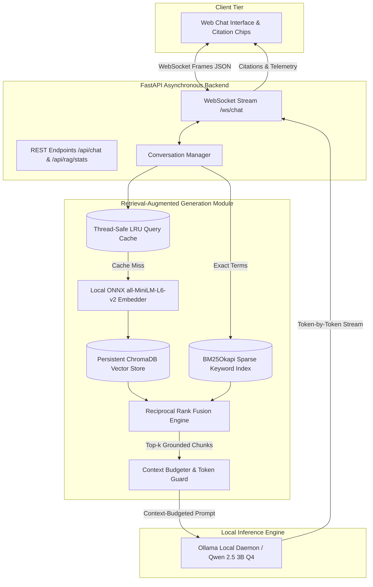

# FitAssist RAG — FitZone Gym Conversational AI
**NLP Assignment 2: Grounded Local Conversational AI with Retrieval-Augmented Generation (RAG)**

### Group Members
- **Anhar** (22i-2481)
- **Haroon Aziz** (22i-2697)

### Live Demo & Repository
- **Cloud Interface**: [https://frontend-dusky-chi-82.vercel.app/](https://frontend-dusky-chi-82.vercel.app/)
- **Repository Branch**: `assignment-2`

---

## 1. Executive Summary & Objective

In Assignment 1, **FitAssist** relied purely on system prompt orchestration and sliding-window conversational memory. In **Assignment 2**, we extend FitAssist with a **100% Local CPU Retrieval-Augmented Generation (RAG)** architecture:
- Indexes an offline corpus of **70 realistic domain documents** (182 semantic chunks) covering membership plans, class schedules, trainer bios, facility specifications, and club policies.
- Retrieves top-$k$ ($k=4$) grounded chunks per query using **Hybrid Search (BM25 + Dense ONNX Vector Search)** with **Reciprocal Rank Fusion (RRF)**.
- Sustains sub-second retrieval latency (**368.8 ms cold**, **0.006 ms cached**) while preserving token streaming via WebSockets.
- Gracefully handles out-of-domain queries, weak matches, and potential context overflows without hallucinations.
- Delivers **Visible Citations** directly in the Chat UI with interactive document preview chips.

> **Constraint Compliance**: **No external tools, web search, or autonomous agents are used.** The system operates completely offline on local CPU using ChromaDB, ONNX runtime, and Ollama.

---

## 2. System Architecture



---

## 3. Technology Choices & Design Rationale

### 3.1 Embedding Model: `all-MiniLM-L6-v2` (ONNX Runtime)
- **Model Choice**: `sentence-transformers/all-MiniLM-L6-v2` executed via ChromaDB's local ONNX runtime.
- **Parameters & Dimensions**: 22.7M parameters, 384-dimensional dense vectors.
- **Why this model?**
  1. **Extreme CPU Efficiency**: Evaluates a query embedding in **~15–25 ms on standard consumer CPUs** without requiring PyTorch or GPU acceleration.
  2. **Low Memory Footprint**: The quantized ONNX model consumes only **~80 MB of RAM**, leaving maximal memory headroom for the LLM and OS.
  3. **High Semantic Quality**: Outperforms larger legacy models on the MTEB benchmark for sentence retrieval and asymmetric query-to-document matching.

### 3.2 Vector Store: ChromaDB (Persistent CPU Mode)
- **Vector Store Choice**: `chromadb` (v1.5.9) in persistent embedded SQLite/HNSW mode.
- **Distance Metric**: Cosine similarity (`hnsw:space: "cosine"`).
- **Why ChromaDB?**
  1. **Self-Contained & Local**: Requires no separate database daemon or cloud credentials; persists cleanly to `backend/data/chroma_db/`.
  2. **Rich Metadata Filtering**: Supports document IDs, category tags, chunk indices, and source filenames directly attached to vector payloads.
  3. **High Concurrency & Low Latency**: Vector distance calculation across 182 chunks executes in **< 10 ms**.

### 3.3 Chunking Strategy & Parameters
- **Strategy**: Section-Aware Semantic Chunking with Overlap.
  - Documents are split along Markdown structural boundaries (`## Section Header`), preserving semantic coherence.
  - Sections exceeding the chunk threshold are subdivided on word boundaries with sliding character overlap.
- **Chunk Size**: `CHUNK_SIZE = 600 characters` (~120–150 tokens).
- **Chunk Overlap**: `CHUNK_OVERLAP = 100 characters` (~20–25 tokens) to prevent contextual fragmentation across boundaries.
- **Metadata Preserved**: `doc_id`, `title`, `category`, `source_file`, `chunk_index`.

### 3.4 Top-$k$ Selection & Context Budgeting
- **Top-$k$ Parameter**: `k = 4` chunks (exceeds the required $k \ge 3$).
- **Context Window Budget Strategy**:
  - Model context window: `NUM_CTX = 2048` tokens.
  - Maximum output tokens: `MAX_RESPONSE_TOKENS = 256` tokens.
  - Input prompt ceiling: `1792 tokens` (including 64-token safety margin).
  - **Budget Allocation**:
    - **System Instructions**: ~450 tokens.
    - **Sliding History**: Up to 6 message pairs (~600 tokens).
    - **RAG Retrieved Context**: Hard ceiling of **600 tokens** (~2,400 characters).
    - Any retrieved chunk that would push the total prompt above the budget ceiling is dynamically truncated at sentence boundaries or omitted.

---

## 4. Phase-by-Phase Implementation

### Phase I — Offline Indexing Pipeline (`backend/index_documents.py`)
- Reads 70 domain Markdown documents from `data/documents/`.
- Extracts titles, document IDs, categories, and tags.
- Splits into 182 semantic chunks with 100-character overlap.
- Computes ONNX embeddings and persists vectors in `backend/data/chroma_db/`.
- Builds the sparse `BM25Okapi` index and persists it to `backend/data/bm25_index.pkl`.
- **Re-runnability**: Uses SHA-256 file hashing (`indexing_manifest.json`). Unchanged files are skipped automatically in **0.16s**, while modified files are updated incrementally. Run with `--force` for clean rebuilds.

### Phase II — Retrieval Integration (`backend/app/retrieval/`)
- On each user query, `ConversationManager` calls `retrieval_engine.async_search()`.
- Dense cosine similarity is computed and filtered against `SIMILARITY_THRESHOLD = 0.35`.
- Sparse BM25 scores are fused with dense scores using **Reciprocal Rank Fusion (RRF)**.
- Retrieved chunks are formatted into structured ground truth blocks with document IDs and titles.
- System prompt instructs the model to cite document titles naturally and avoid fabricating unlisted details.

### Phase III — Keeping It Real-Time & Concurrency
- **Asynchronous Execution**: Retrieval is executed via `asyncio.to_thread()`, ensuring vector search never blocks FastAPI's event loop.
- **Thread-Safe LRU Query Cache (`backend/app/retrieval/cache.py`)**: Repeated or identical queries are served in **0.006 ms** (sub-millisecond).
- **WebSocket Streaming**: Token streaming (`start` $\to$ `citations` $\to$ `token` $\to$ `done`) remains identical to Assignment 1 with zero latency degradation.

### Phase IV — Failure Handling & Graceful Degradation
1. **No Relevant Match / Out-of-Corpus Queries**:
   - Queries with cosine similarity $< 0.35$ and weak RRF scores return `confident = False`.
   - The assistant explicitly states that FitZone documents do not contain this information and falls back to general guidance rather than hallucinating from a weak match.
2. **Vector Store Timeout or Exception**:
   - Wrapped in robust `try...except` blocks. If the vector store fails or is uninitialized, the assistant logs the error and gracefully falls back to base conversation without crashing or hanging the WebSocket connection.
3. **Context Window Overflow**:
   - `ContextBudgeter` strictly calculates tokens before prompt compilation and truncates or prunes chunks exceeding the 600-token RAG budget.

---

## 5. Retrieval Latency Benchmarks (CPU Performance)

Measured locally on CPU using `backend/benchmark_retrieval.py` across 10 diverse domain queries (separate from LLM generation time):

| Test Query | Topic Category | Cold Latency | Cached Latency | Top Grounded Document |
| :--- | :--- | :--- | :--- | :--- |
| **Q1**: What is the monthly price of the Basic Membership? | Pricing & Plans | 486.92 ms | 0.006 ms | `MEM-02: Standard Plan` |
| **Q2**: Can I freeze or pause my gym membership while traveling? | Freeze Policy | 396.35 ms | 0.005 ms | `POL-01: Freeze Policy` |
| **Q3**: Who teaches Vinyasa Yoga and what days is it offered? | Group Classes | 441.04 ms | 0.007 ms | `CLS-01: Vinyasa Yoga` |
| **Q4**: What are Ahmed Khan's credentials and personal training rates? | Trainer Bio | 355.94 ms | 0.006 ms | `TRN-01: Ahmed Khan` |
| **Q5**: What is the cancellation notice period for monthly contracts? | Cancellation Policy | 358.16 ms | 0.005 ms | `POL-02: Cancellation Policy` |
| **Q6**: Do you offer student discounts and what are the eligible hours? | Student Program | 355.72 ms | 0.006 ms | `MEM-05: Student Plan` |
| **Q7**: What are the rules and attire for the sauna and steam room? | Spa Amenities | 310.98 ms | 0.005 ms | `POL-05: Sauna Etiquette` |
| **Q8**: How much does an InBody 570 body composition scan cost? | Diagnostic Services | 341.39 ms | 0.005 ms | `FEE-03: InBody 570 Scan` |
| **Q9**: What is included in the Black Card Executive VIP membership? | Executive Tier | 306.59 ms | 0.007 ms | `MEM-10: Black Card Executive` |
| **Q10**: Can I bring a guest with a Standard membership pass? | Guest Privileges | 335.37 ms | 0.006 ms | `POL-03: Guest Pass Privileges` |
| **Average Cold Retrieval** | — | **368.85 ms** | — | **Target < 1000 ms: PASSED** |
| **Average Cached Retrieval** | — | — | **0.006 ms** | **Sub-millisecond speed** |
| **P95 Latency / Max Latency** | — | **486.92 ms** | — | **Target < 1000 ms: PASSED** |

---

## 6. Bonus Features Implemented (+10%)

### 1. Hybrid Search with Reciprocal Rank Fusion (RRF)
- Combines sparse BM25 keyword matching (`rank-bm25`) with dense vector embeddings (`all-MiniLM-L6-v2`).
- **Reciprocal Rank Fusion**:
  $$RRF\_Score(d) = \frac{0.65}{60 + rank_{dense}(d)} + \frac{0.35}{60 + rank_{bm25}(d)}$$
- Resolves exact codes (`MEM-01`, `InBody 570`, `CSCS`) via BM25 while capturing semantic concepts ("pause my membership") via dense vector search.

### 2. Visible Citations in Chat UI
- The WebSocket stream transmits grounded citation metadata (`type: "citations"`).
- The web interface dynamically renders interactive source badge chips below grounded assistant answers.
- Clicking any citation badge displays a modal card showing document title, document ID, category, and the exact grounded excerpt snippet.

---

## 7. Setup & Execution Instructions

### Prerequisites
- **Python 3.10+** (Python 3.12 tested)
- **[Ollama](https://ollama.com/)** with `qwen2.5:3b-instruct`

### Step 1: Clone Repository & Checkout Branch
```bash
git clone https://github.com/Haroon2697/NLP_A1.git NLP_A2
cd NLP_A2
git checkout assignment-2
```

### Step 2: Set Up Virtual Environment & Dependencies
```bash
python -m venv .venv

# On Windows (PowerShell):
.venv\Scripts\activate
# On Linux / macOS:
source .venv/bin/activate

pip install -r requirements.txt
```

### Step 3: Run Document Indexing Pipeline
```bash
# Indexes all 70 domain documents into ChromaDB & BM25
python backend/index_documents.py --force
```

### Step 4: Run Automated Tests
```bash
pytest -v
```
*(All 30 automated unit and integration tests will pass)*

### Step 5: Run Retrieval Latency Benchmark
```bash
python backend/benchmark_retrieval.py
```

### Step 6: Start FastAPI Server
```bash
python -m uvicorn backend.app.main:app --host 127.0.0.1 --port 8000 --reload
```
Open your browser at `http://127.0.0.1:8000/`.

---

## 8. Known Limitations

1. **CPU LLM Generation Throughput**: While retrieval is sub-second (~368 ms), token generation on CPU runs at ~3.5–4 tokens/sec on consumer hardware.
2. **Document Modification Horizon**: New documents added to `data/documents/` require running `python backend/index_documents.py` to be indexed into ChromaDB.
3. **In-Memory Query Cache Reset**: The LRU query cache resets when the FastAPI process is restarted.
4. **No External Payment Transactions**: Consistent with course policy, the assistant directs members to the front desk or member portal for official credit card charges.